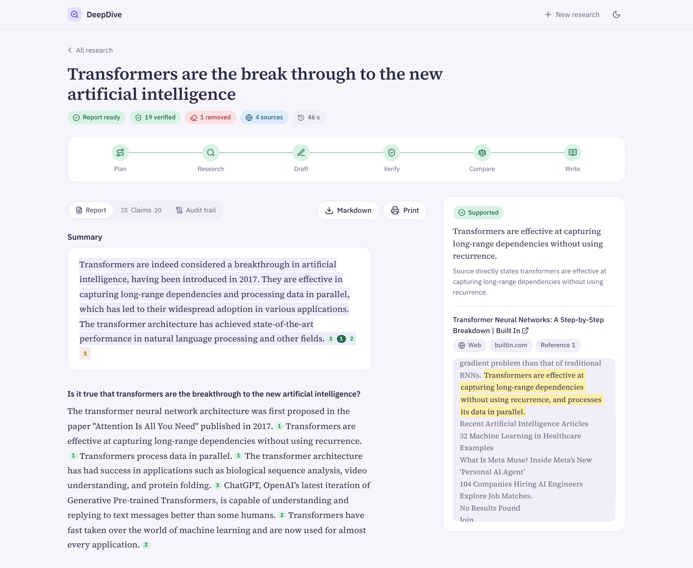
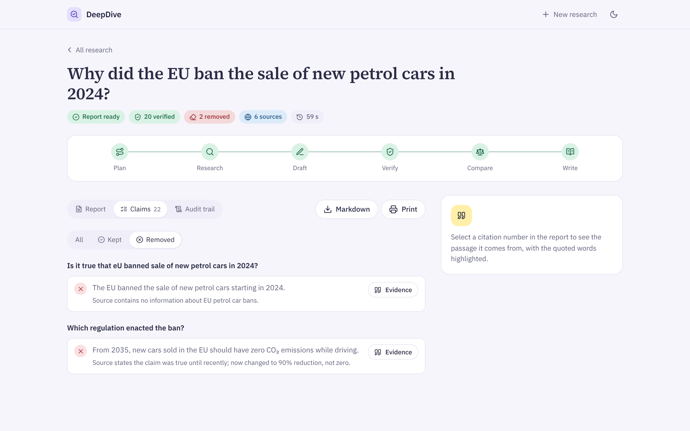
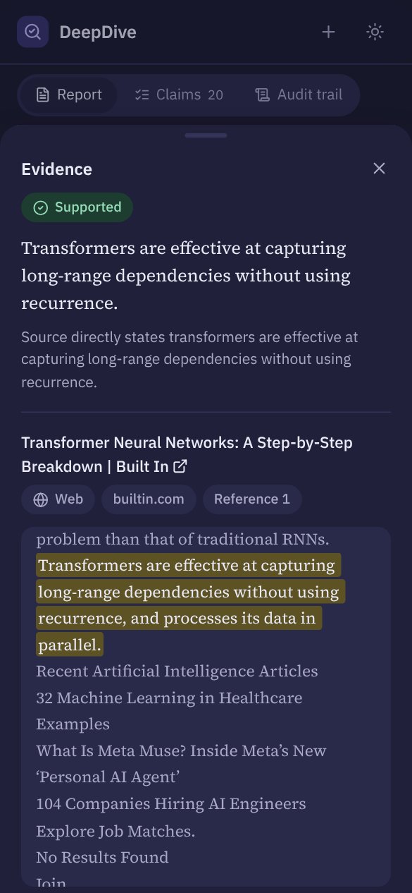
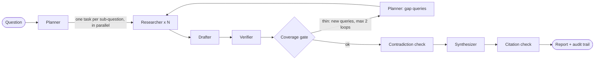

# DeepDive : a self-verifying research analyst

DeepDive answers a research question with a structured report in which **every sentence has
been checked against the source passage it cites**. Claims the sources don't support are
removed, thin topics trigger more research, and the whole run is logged so you can see what
was kept, what was rejected, and why.

Built for **Agent Arena 2026 · Track 01 (DeepDive)**. All LLM and embedding calls go through
**[Mesh API](https://meshapi.ai)**.



| Removed claims, with the verifier's reason | Phone, dark mode |
| --- | --- |
|  |  |

_Screenshots are real runs: "Transformers are the breakthrough to the new artificial intelligence" and
the false-premise benchmark question "Why did the EU ban the sale of new petrol cars in 2024?"._

## How the agents cooperate



| Agent | Job | Sees |
| --- | --- | --- |
| **Planner** | Splits the question into sub-questions with search queries; on a loop-back, writes new queries from the verifier's rejection reasons | the question |
| **Researcher** | Searches the web (and your uploaded documents), fetches pages, stores every chunk with its source, extracts findings that cite chunk IDs | the chunks it fetched |
| **Drafter** | Turns findings into atomic claims, one checkable fact each, citing chunks | findings + their chunks |
| **Verifier** | Checks **one claim against only the text it cites**: supported, partial, unsupported or contradicted, with an exact evidence quote | one claim + its chunks |
| **Synthesizer** | Writes the report from **verified claims only**; every sentence lists its claim IDs. Code then adds a verified figure the writer left out when two passages agree on it | kept claims |

The coordinator is a LangGraph `StateGraph`: parallel research with `Send`, a conditional
**coverage gate** that loops back to research when a sub-question has fewer than 2 verified
claims from 2 independent domains (bounded by `MAX_LOOPS`), and deterministic code for routing and citation checks.

### Finding the right evidence

**Hybrid ranking.** Search results are first checked for meaning (Mesh embeddings), so a page that only
shares a word with the question is skipped before it is fetched: an AI question about "transformers"
no longer pulls in power-grid transformers. Passages are then ranked by keywords and meaning together:
keywords keep exact names, figures and law titles strong, meaning keeps the topic right. The audit
trail lists every skipped result. If embeddings are unavailable, ranking falls back to keywords.

### What makes the citations trustworthy

1. **Isolated verifier on a different model family** from the drafter, so the system is not grading itself.
2. **Quote guard in code:** the verifier must quote the source verbatim; if the quote isn't
   literally in the cited chunk, the claim is downgraded to unsupported. Only typesetting is
   ignored (PDF ligatures such as "fi", words hyphenated across lines, case and spacing); a list
   quote such as an author line must have every name in the passage, in order.
3. **Partial claims are narrowed** to what the source actually says and re-verified once.
4. **Citation check in code:** any report sentence without a verified claim ID is deleted and logged.
5. **Audit trail:** sub-questions, queries, URLs fetched and failed, every verdict with its reason,
   loop-backs, removed sentences, tokens and latency per step.

### Questions about your own documents

Attach a paper, report or notes and ask about **it** ("what optimizations does this paper make?",
"summarize the attached report") and DeepDive switches to **document mode**: it answers from your
documents only. The planner sees each document's opening text (so it plans with the real title,
not "the paper"); there is no web search and no premise check; the title page is always among the
passages read, so title, authors, year and venue can be answered; more passages per sub-question
come from the document; and one document counts as enough sources for a section. The audit trail
says "answering from your documents only". A question that doesn't refer to the attachments
("what are the risks of the battery market?") still uses the web plus your documents.

Want the web too? Tick **Also search the web** (shown once documents are attached). Every research
step then reads both, documents first: of the passages read for each part of the question, up to 6
are reserved for your documents and the web fills the rest; web queries name the document's title,
so results stay connected to it; and the writer sees which verified claims come from your
document, listed first, so the report leads with what the document says and adds what the web
adds. Follow-ups and **Edit & run again** keep the choice (the editor has the same switch).

### Follow-up research in the same thread

Every finished report ends with **Continue this research**: ask a follow-up ("and what about
India?"), or press **Research this further** on any verified claim. The follow-up is a new run
linked to the earlier one (shown as "Follows …" on the page):

- the planner sees the earlier questions and their verified findings, rewrites the follow-up as a
  self-contained question ("Researched as: …") and plans only what is still open;
- the passages the earlier report cited join the researcher's ranking next to new search results,
  so known evidence costs no search or fetch;
- nothing is trusted because it was trusted before: only kept claims are carried over, and every
  claim in the follow-up is verified again. The audit trail shows how many passages were reused.

API: `POST /api/runs/{id}/followup {"question": "..."}`.

### Built for a small credit balance

- Balance read from Mesh (`GET /v1/balance`) before every run: a banner below **$5**, new runs refused below **$1**.
- Every call is priced with live Mesh prices; cost is shown per step and per run, and a run stops at `RUN_BUDGET_USD`.
- Cheap models for extraction, drafting and writing; a cheap reasoning model for planning (`gpt-oss-120b`,
  falling back to `gpt-5-nano`), since the plan decides every search; the stronger model only for the
  verifier, where accuracy is decided.
- Short prompts, compact output formats, `max_tokens` on every call, and a free code path that accepts claims copied word for word from a whole source sentence.
- `python -m scripts.mesh_account` (free) shows your balance, the price of each configured model and the estimated cost per run.
- Developer view (`DEV_MODE=true`): a **Tokens (dev)** tab on each run and a `/dev/usage` page show input and output tokens, calls and cost per agent and per step, live while a run is going.

Bonus features: explicit LangGraph loop, contradiction detection across sources, visible
source-quality weighting (`app/core/scoring.py`), document upload, Markdown and printable export.

## Run it

```bash
git clone <this repo> && cd deepdive
python -m venv .venv && source .venv/bin/activate      # Python 3.10+
pip install -r requirements.txt
cp .env.example .env                                     # add your MESH_API_KEY (rsk_...)
python -m scripts.mesh_account                           # free: balance, model prices, cost per run
python -m scripts.smoke_mesh                             # checks each configured model via Mesh (< 1 cent)
python -m scripts.check_search                           # free: checks web search returns results
python run.py                                            # http://127.0.0.1:8000
```

- Web UI (works on phone, tablet and desktop, light and dark, installable as an app): ask a question,
  watch the pipeline, read the report, click any citation mark to see
  the exact passage, open the **Claims** tab to see what was removed, and the **Audit trail** tab.
- Fix a question: **Edit & run again** (on a finished run) opens the question and depth for editing
  and starts a corrected run with the same documents and, for a follow-up, the same earlier
  research. The original run is kept.
- Spotted a mistake mid-run? **Stop** ends the run before its next step (calls already sent
  finish; no new ones start) and opens the question editor at once. The stopped run keeps its
  audit trail so far. Every search and page it read is already cached, so the corrected run reuses
  them wherever its own plan needs them; drafts and verdicts are made fresh for the new question.
- Tidy the list: each row on the home page has a delete button; **Select** adds checkboxes with
  **Select all** and **Delete selected**. Deleting asks for confirmation, removes the run's report,
  claims and audit trail, and skips runs that are still in progress.
- Terminal: `python -m scripts.cli "your question"`
- API docs: http://127.0.0.1:8000/docs
- No key yet? `python -m scripts.offline_demo` creates a demo run from fake data so you can see the UI.

Search: set `TAVILY_API_KEY` (free tier, no card) for reliable results. Without it DuckDuckGo is
used, which often rate-limits and returns nothing. `python -m scripts.check_search` (free) tests
search before you spend credits; a run that finds no sources at all stops before drafting.
Search is not an LLM call.

Hosting it publicly: set `RUN_ACCESS_CODE` so only people with the code can start research (they
type it once on the home page; reading reports stays open), and `MAX_RUNS_PER_DAY` to cap credit
spend (extra runs get a 429 with a plain message). Keep `DEV_MODE=false`. The app sends security
headers (CSP, no framing, `nosniff`, HSTS behind HTTPS) and shows a 404 page for unknown runs.
`requirements.txt` pins the exact versions behind the published results (Python 3.11-3.14).
Free hosting on Hugging Face Spaces (Docker) takes one script and three secrets: see
[docs/DEPLOY.md](docs/DEPLOY.md).

## Self-evaluation

We measure two things separately: whether the verifier catches bad citations (labelled pairs
with known answers), and whether final reports are grounded and complete (18 test questions
across market, finance, policy, science, recent events and false-premise questions). An
ablation with verification switched off shows what the verifier contributes.
Groundedness is judged by a **different model** (`MODEL_JUDGE`) from the verifier.

| Metric | Definition |
| --- | --- |
| Groundedness | share of final sentences whose cited passages support them, re-checked by the judge model |
| Uncited sentences | share of final sentences with no verified claim ID (target 0) |
| Coverage | share of hand-written key points per question that the report covers |
| Claim pass rate | share of drafted claims that survive verification |
| Bad-citation recall / precision | verifier on labelled pairs, positive class = unsupported or contradicted |

```bash
python -m evaluation.run_eval --set verifier
python -m evaluation.run_eval --set questions --limit 5 --max-usd 1.0
python -m evaluation.run_eval --set questions --limit 5 --max-usd 1.0 --ablation
python -m evaluation.run_benchmark            # 10-question regression benchmark, stops at $1.50
```

The benchmark (`evaluation/data/benchmark.jsonl`) has reference answers checked against
official sources, including two false-premise questions. For each key fact it reports the
stage where the fact was lost (search, extraction, drafting, verification or writing), whether
the cited passage really states it, any known-wrong claim that slipped through, and tokens and
cost per agent.

The question runner stops early at `--max-usd` or when the Mesh balance reaches the $1 floor, and records why.

### Results

<!-- EVAL:START -->
_Last run: 20261019T183845Z. Raw numbers: `evaluation/results/eval_20261019T183845Z.json`._

**Verifier on labelled pairs**

| Pairs | Bad-citation recall | Bad-citation precision | Exact label accuracy |
| --- | --- | --- | --- |
| 16 | 0.8889 | 1.0 | 0.875 |

**Full runs: With verification** (10 questions, judge `google/gemini-2.5-flash`)

| Groundedness | Uncited sentences | Coverage | Claim pass rate | Loop-back rate | Avg seconds | Avg tokens | Avg cost (USD) |
| --- | --- | --- | --- | --- | --- | --- | --- |
| 0.823 | 0.0 | 0.675 | 0.962 | 0.0 | 93.24 | 39069.5 | 0.0375 |

**Full runs: Ablation: verification off** (10 questions, judge `google/gemini-2.5-flash`)

| Groundedness | Uncited sentences | Coverage | Claim pass rate | Loop-back rate | Avg seconds | Avg tokens | Avg cost (USD) |
| --- | --- | --- | --- | --- | --- | --- | --- |
| 0.7768 | 0.0 | 0.675 | 1.0 | 0.0 | 49.07 | 27257.5 | 0.0204 |

<!-- EVAL:END -->

## Key design decisions

See [`docs/DESIGN_DECISIONS.md`](docs/DESIGN_DECISIONS.md). In short: verification is
claim-level and isolated; code (not the LLM) has the final word on quotes and citations;
thin evidence loops back instead of being padded; trust policy is a visible table, not a prompt.

## Project layout

```
app/            FastAPI app (Flask-style factory + routers), agents, graph, core logic, UI
evaluation/     test sets, metrics, runner, committed results
scripts/        cli, smoke_mesh, offline_demo, check_mesh_only
tests/          offline tests (fake Mesh, no network)
docs/           implementation plan, architecture, hackathon requirements, design decisions
```

Full architecture: [`docs/ARCHITECTURE.md`](docs/ARCHITECTURE.md).
