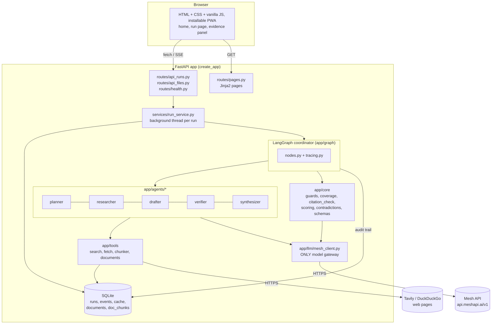
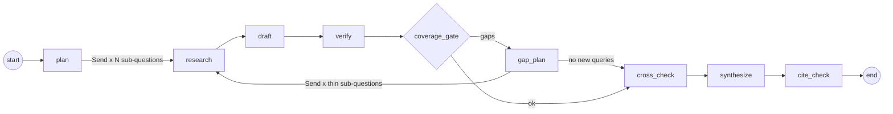
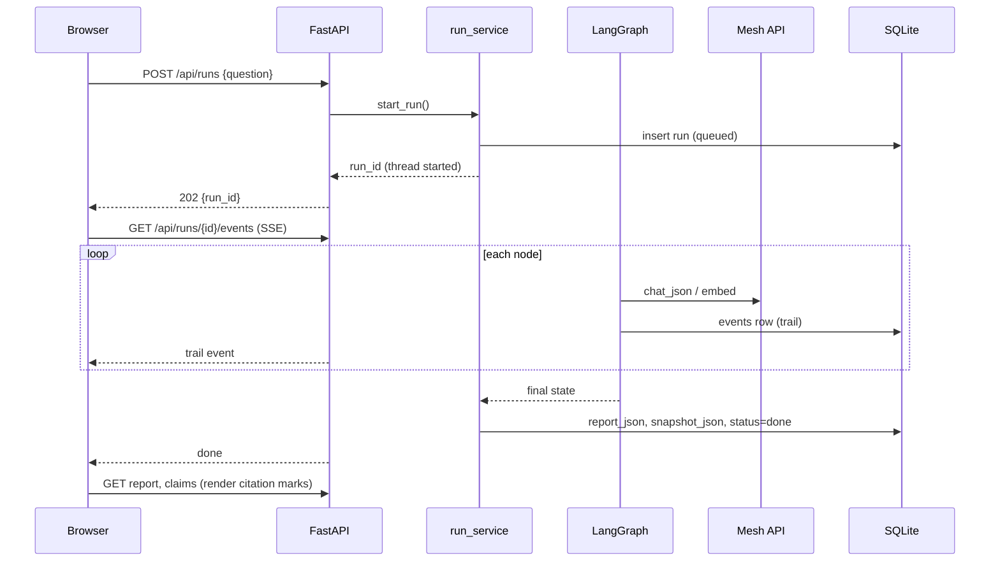

# DeepDive architecture

One FastAPI process serves the web UI and the JSON API, and runs each research job on a
background thread through a LangGraph `StateGraph`. All model calls leave the process through
one module, `app/llm/mesh_client.py`, to Mesh API.

## 1. System view



## 2. Graph (the coordinator)



| Node | Agent / code | Reads | Writes |
| --- | --- | --- | --- |
| `plan` | Planner | question, depth | `sub_questions`, `loops`, `round=0` |
| `research` (parallel) | Researcher | one `ResearchTask` | `sources`, `chunks`, `findings`, `research_log` (merged by reducers) |
| `draft` | Drafter | findings of this round | `claims` (+) |
| `verify` | Verifier (+ quote guard) | claims without a verdict | `verdicts` (+), narrowed child `claims` (+) |
| `coverage_gate` | code (router) | claims, verdicts, chunks, sources, loops | routes `gaps` / `ok`; logs coverage |
| `gap_plan` | Planner (gap prompt) | rejection reasons, coverage | `sub_questions` (new queries), `loops`, `round+1`, `gap_queries` |
| `cross_check` | code + verifier model | kept claims, source tiers, premise-check sub-questions | `contradictions`; a code `CONTRADICTED` verdict for a blog/industry claim an official source contradicts |
| `synthesize` | Synthesizer + code | kept claims, contradictions, coverage | `report`; code appends corroborated verified figures the writer skipped (`core/key_claims.py`) |
| `cite_check` | code | report, kept claims | final `report` (+ references, markdown, dropped sentences) |

Every node is wrapped by `traced(name)`: it writes `start`/`end`/`error` rows to `events` with
summary, payload, tokens, latency and models, and adds tokens to the run budget.

### State (`app/graph/state.py`)

```python
class ResearchState(TypedDict, total=False):
    run_id: str; question: str; depth: str; file_ids: list[str]
    sub_questions: list[SubQuestion]; loops: dict[str, int]; round: int
    gaps: list[str]; gap_queries: dict[str, list[str]]
    sources: Annotated[dict[str, Source], merge_dicts]      # parallel-safe
    chunks: Annotated[dict[str, Chunk], merge_dicts]
    findings: Annotated[list[Finding], operator.add]
    research_log: Annotated[list[dict], operator.add]
    claims: Annotated[list[Claim], operator.add]
    verdicts: Annotated[list[Verdict], operator.add]
    contradictions: list[Contradiction]
    report: Report | None
```

## 3. Request lifecycle



## 4. Data model (SQLite via SQLModel)

| Table | Columns (key) | Notes |
| --- | --- | --- |
| `runs` | id, question, depth, status, error, tokens, cost_usd, created_at, finished_at, report_json, snapshot_json, file_ids_json | snapshot = sub-questions, sources, chunks, findings, claims (+kept), verdicts, contradictions, research log, loops |
| `events` | id, run_id, node, phase, summary, payload_json, tokens, cost_usd, latency_ms, models, ts | the audit trail; SSE reads new rows |
| `cache` | key, kind (search/fetch), value_json | makes reruns cheap and comparable |
| `documents` | id, filename, pages | uploads |
| `doc_chunks` | id, document_id, page, text, embedding_json | Mesh embeddings, numpy cosine search |

## 5. Folder structure

```
deepdive/
├── CLAUDE.md                     project rules for Claude Code / contributors
├── README.md                     what, how agents cooperate, how to run, results
├── requirements.txt              runtime deps (FastAPI + openai client for Mesh)
├── requirements-dev.txt          + pytest, ruff
├── pyproject.toml                ruff + pytest config
├── .env.example                  every setting, no secrets
├── .gitignore                    includes .env and data/
├── run.py                        dev server (uvicorn, factory)
├── .github/workflows/ci.yml      mesh-only check, ruff, pytest, gitleaks, optional Mesh smoke
├── docs/
│   ├── IMPLEMENTATION_PLAN.md    requirements, scope, plan
│   ├── ARCHITECTURE.md           this file
│   ├── HACKATHON_REQUIREMENTS.md brief → code checklist
│   └── DESIGN_DECISIONS.md       decision log (linked from README)
├── app/
│   ├── __init__.py               create_app() factory
│   ├── CLAUDE.md                 app-level rules + API table
│   ├── config.py                 Settings (pydantic-settings)
│   ├── routes/                   "blueprints"
│   │   ├── pages.py              GET /, GET /runs/{id}
│   │   ├── health.py             GET /api/health
│   │   ├── api_runs.py           runs, SSE events, report, claims, trail, export, followup
│   │   ├── api_files.py          POST /api/files
│   │   └── deps.py               templates, get_run_or_404
│   ├── templates/                base.html, index.html, run.html
│   ├── static/css/app.css        states, citation marks, report typography
│   ├── static/js/                common.js (el, api), index.js, run.js
│   ├── graph/                    state.py, nodes.py, builder.py, tracing.py
│   ├── agents/
│   │   ├── CLAUDE.md             rules shared by all agents
│   │   ├── base.py               load_prompt (+ injection guard), chunk_block
│   │   ├── planner/              agent.py, prompt.md, gap_prompt.md, SKILL.md
│   │   ├── researcher/           agent.py, prompt.md, SKILL.md
│   │   ├── drafter/              agent.py, prompt.md, SKILL.md
│   │   ├── verifier/             agent.py, prompt.md, SKILL.md
│   │   └── synthesizer/          agent.py, prompt.md, SKILL.md
│   ├── core/                     schemas, guards, coverage, citation_check, scoring, contradictions, key_claims, utils
│   ├── llm/                      mesh_client.py, usage.py, billing.py, schema_hint.py
│   ├── tools/                    search.py, fetch.py, chunker.py, documents.py
│   ├── db/                       models.py, session.py, repository.py
│   ├── services/                 run_service.py
│   └── export/                   exporters.py (markdown → printable HTML)
├── evaluation/
│   ├── CLAUDE.md                 eval rules
│   ├── data/                     questions.jsonl, verifier_pairs.jsonl
│   ├── metrics.py, run_eval.py
│   └── results/                  committed JSON results
├── scripts/                      cli.py, mesh_account.py, smoke_mesh.py, setup_balance_alert.py,
│                                 offline_demo.py, check_mesh_only.py
├── tests/                        fakes.py (FakeMesh), conftest.py, test_core.py, test_graph_offline.py, test_routes.py
└── data/                         SQLite DB + uploads (gitignored)
```

## 6. Security and reliability

- Keys only from env; health endpoint reports presence, never values; gitleaks in CI.
- Prompt-injection guard appended to every system prompt; evidence wrapped in `<CHUNK>` blocks.
- Browser renders API text with `textContent`; links pass `safeUrl()` (http/https only);
  export escapes raw HTML.
- Uploads: allow-listed extensions, 20 MB cap, server-generated filenames.
- Retries with backoff on Mesh for transient errors only (never on 402); failed search/fetch never
  fails a run; loops bounded; SQLite WAL so SSE reads don't block writes.

## 7. Credit control

- `app/llm/billing.py`: `GET /v1/balance` (cached 60 s) gates runs and uploads: warn below
  `LOW_BALANCE_ALERT_USD` ($5), refuse below `MIN_BALANCE_STOP_USD` ($1). `GET /v1/models` gives live
  per-1M-token prices (cached 24 h in `data/mesh_prices.json`). Neither call spends credits.
- `app/llm/usage.py`: every Mesh call is priced; `traced` stores cost per node in `events.cost_usd`,
  totals go to `runs.cost_usd`; `RUN_BUDGET_USD` stops a runaway run, and the coverage gate skips
  loop-backs after 60% of it so the run still ends with a report.
- Token discipline: compact `schema_hint` output formats, short prompt files, `max_tokens` per agent,
  the drafter sees findings only, the verifier has a free whole-sentence verbatim path.
